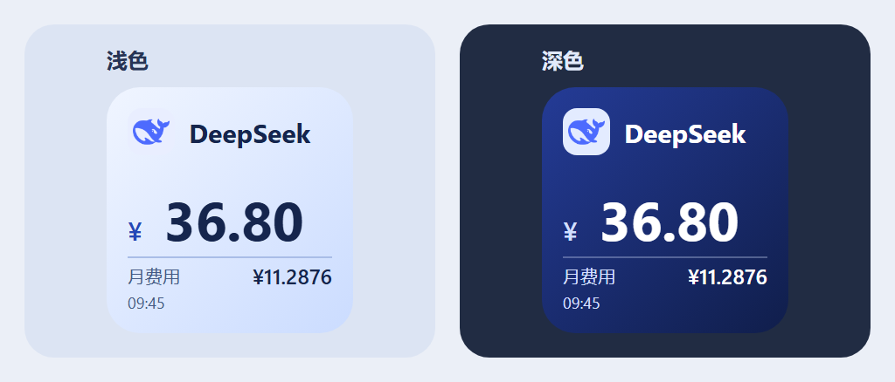
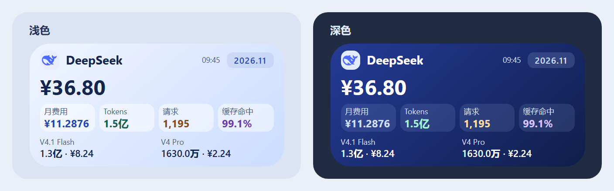
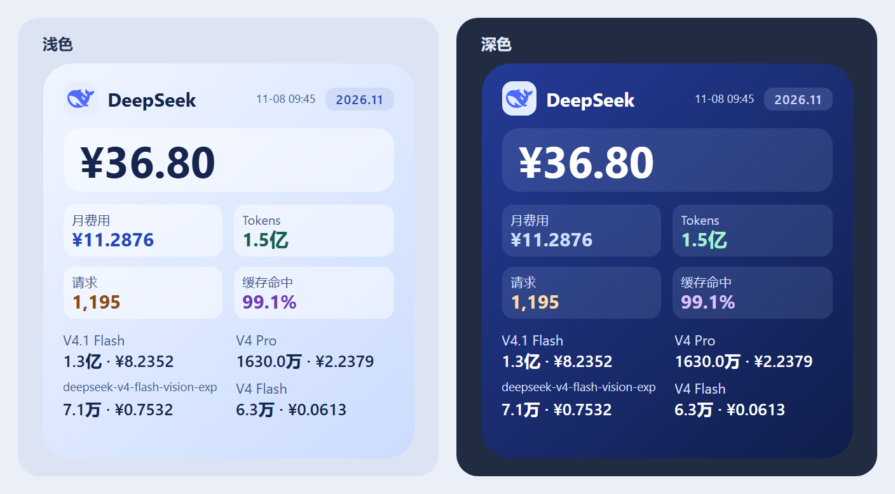

# DeepSeek 用量

在 iPhone 主屏幕查看 DeepSeek 账户余额和月度用量的 Scripting 小组件。支持小、中、大三种尺寸，以及浅色和深色主题。

小组件使用 DeepSeek 开放平台网页登录凭据 `userToken`，可查看账户余额和本月费用。中号和大号还会显示 Tokens、请求数、缓存命中率和模型明细。

## 远程安装与更新

**[在 iPhone 上打开 Scripting 安装](https://www.scripting.fun/import_scripts/?urls=%5B%22https%3A%2F%2Fgithub.com%2Fyouniube%2Fscripting-deepseek-widget%2Ftree%2Fmain%2Fscripts%2FDeepSeek%2520%25E7%2594%25A8%25E9%2587%258F%22%5D)**

首次安装时，用 Safari 打开链接，在 Scripting 里确认导入。运行 **DeepSeek 用量**，填写开放平台 `userToken`，再把 Scripting 小组件添加到主屏幕并选中此脚本。

在原脚本的设置里打开 **远程资源**，填写或核对下面的订阅地址，再在 App 内检查更新。需要自动更新时，可设置检查间隔并开启 App 的自动更新。

```text
https://github.com/youniube/scripting-deepseek-widget/tree/main/scripts/DeepSeek%20%E7%94%A8%E9%87%8F
```

[查看配置方法和数据说明](scripts/DeepSeek%20%E7%94%A8%E9%87%8F/README.md) · [Scripting 远程来源说明](https://scriptingapp.github.io/guide/Script/Script#remote-script-sources-and-updates)

## 预览

预览根据组件界面生成，使用模拟数据。

### 小号



### 中号



### 大号


